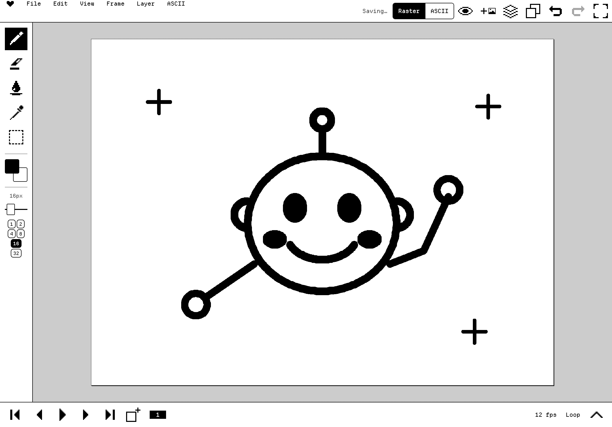
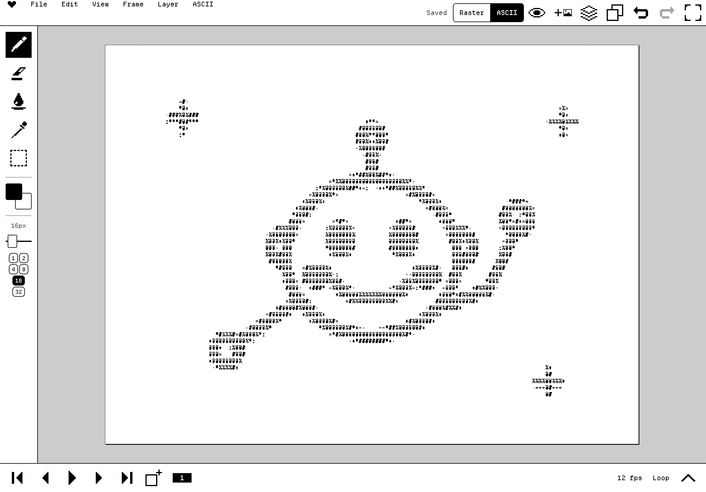
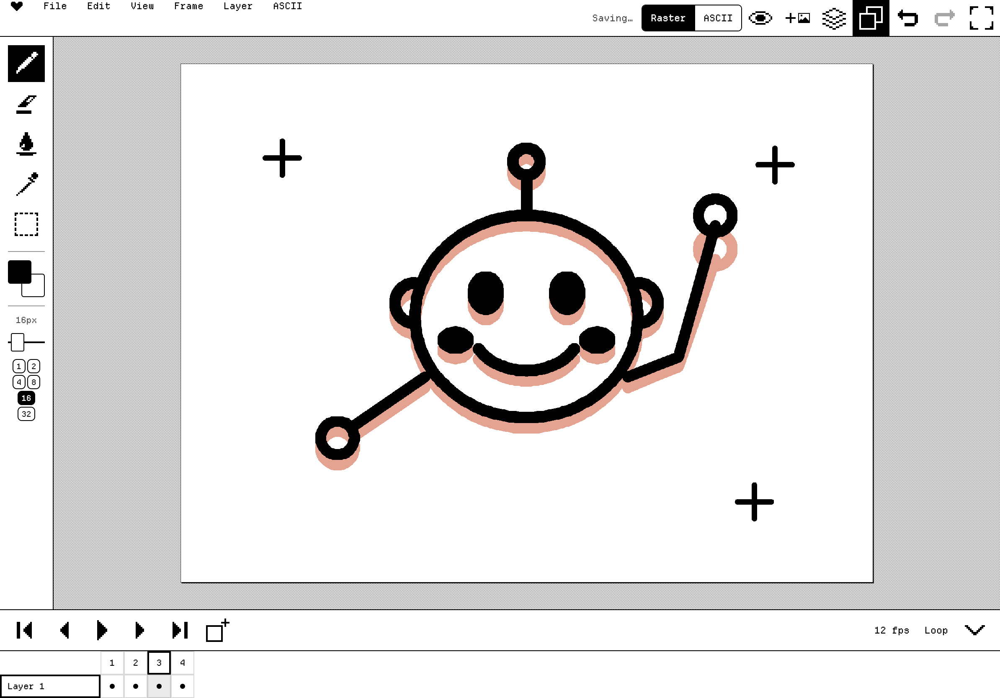
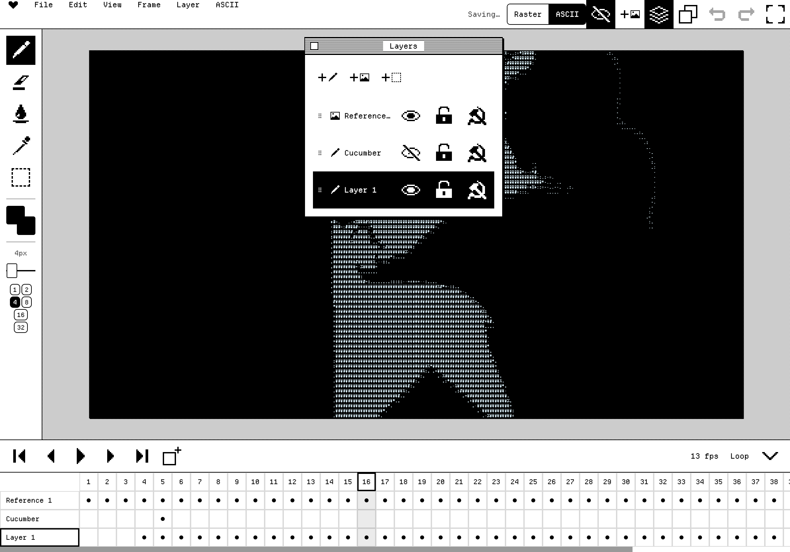
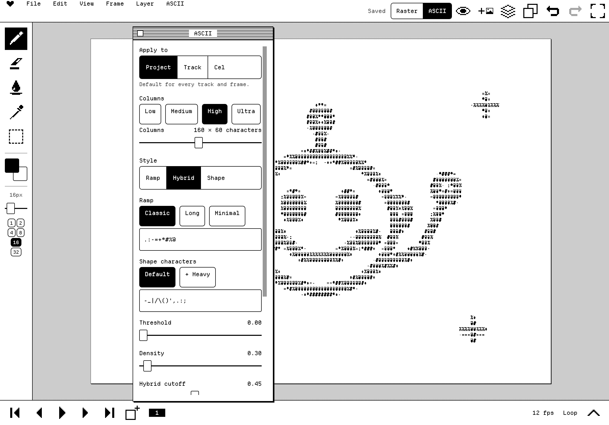
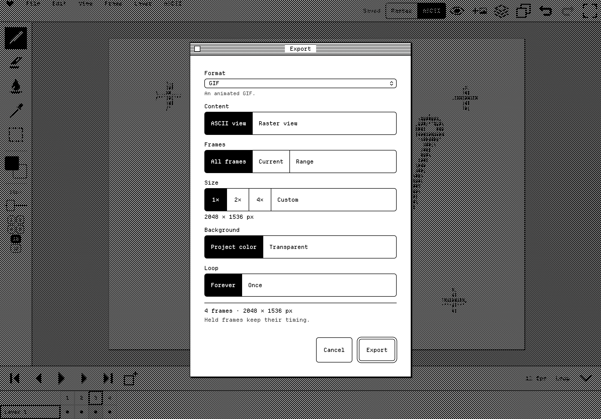
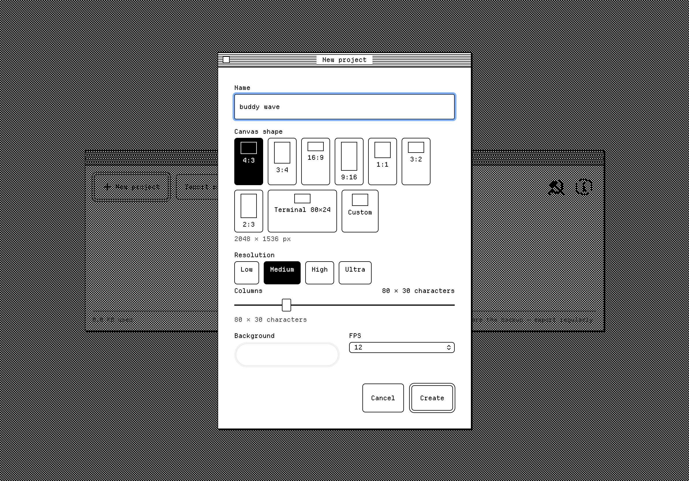

# ascii_buddy&lt;3

A retro, minimalist drawing and frame-by-frame animation tool that turns freehand drawings into ASCII art. Draw with an Apple Pencil (or mouse), watch the drawing become characters live, animate it frame by frame, and export it as GIF, MP4, PDF, text, HTML and more.

No accounts, no server, no analytics, and no network requests after the page loads: everything is one HTML file and your projects live in your browser's storage.

<p align="center">
  
  <br><em>A 49-frame rotoscoped animation, exported as a GIF straight from the app.</em>
</p>

<p align="center">
  
  
</p>
<p align="center"><em>The drawing on the left, the ASCII view on the right: same frame, rendered live as characters.</em></p>

## Who made this

I'm an artist, and I built ascii_buddy<3 as a tool for my own artistic project: a personal drawing and animation practice. It's shared here so people can see how it works, not as a product. If you'd like to connect about art, find me on Instagram at **[@laying_thing](https://www.instagram.com/laying_thing/)**.

## The idea

Most ASCII art tools make you type characters one by one, or convert a finished image in one shot. ascii_buddy<3 does neither. You draw normally, with a pencil, like in a simple paint app, while a character grid sits over the canvas. The app turns what you draw into ASCII as you go, so you can sketch, check the ASCII, and keep drawing.

**The drawing is the source; the ASCII is a view of it.** Because the characters are always computed from the drawing, you can change the grid size, the conversion style or the character set at any time without losing anything. The same conversion engine renders the screen and every export, so what you see is what you export.

It is also a flipbook. Add frames, turn on onion skin to see the previous frame as a ghost, and play the animation back as a drawing or as ASCII.

The interface looks like a 1984 Macintosh: 1-bit black and white, pixel fonts, striped title bars. It behaves like a modern app, with gestures, full undo and autosave. It is built for **iPad + Apple Pencil** first, and works on desktop with a mouse and keyboard too.

## A look around (iPad, landscape)

| | |
|---|---|
|  |  |
| **Frame-by-frame animation.** The expanded timeline shows every track across 49 frames, with onion skin on. | **Layers.** A video reference track and two drawing tracks, each with visibility, lock and settings. |
|  |  |
| **ASCII settings.** Grid density (263 × 74 characters here), Ramp / Hybrid / Shape styles, character ramps, threshold, density, fonts. Set per project, per track or per cel. | **Export.** GIF, MP4, PNG, PDF, TXT, ANSI, SVG, a self-contained HTML player and more, in ASCII or raster. |

<p align="center">
  
  <br><em>New project: canvas shape, resolution, character grid, background and frame rate.</em>
</p>

## Documentation

See [ASCII_BUDDY_SPEC.md](ASCII_BUDDY_SPEC.md) for the full product and technical spec, [IPAD_LEARNINGS.md](IPAD_LEARNINGS.md) for reusable iPad/Safari engineering notes, [DECISIONS.md](DECISIONS.md) for the choices made along the way, [TESTING.md](TESTING.md) for the manual iPad checklist and [IDEAS.md](IDEAS.md) for what could come next.

## What's in it

- **Drawing:** pen and eraser (round/square, sizes), fill, eyedropper, rectangle/lasso select with transforms, copy/cut/paste across frames and tracks, palettes with import/export, replace color.
- **ASCII conversion:** Ramp, Shape-aware and Hybrid styles, extended character set, two fonts, crisp glyphs, colors-to-characters mapping, and a project → track → cel settings cascade.
- **Tracks and frames:** multiple drawing tracks with occupancy, static tracks, reference images (single, bulk, or video import), a timeline with holds, reorder, multi-select, playback modes, onion skin.
- **Import:** many images at once (natural sort, size modes), or a video sampled to frames.
- **Export:** PNG, PNG sequence, GIF, MP4, PDF (pages or contact sheet), TXT, ANSI, SVG, a self-contained HTML player, sprite sheet + JSON, copy as text; and a `.buddy` project file for backup and moving between devices.
- **Editor comforts:** keyboard shortcuts (below), focus mode (`F`), left-handed layout, optional offline mode.

## Build

```bash
npm install
npm run build
```

This produces `dist/index.html` — one self-contained file with all JS, CSS, fonts and icons inlined (about 600 kB; the MP4 encoder loads only when you export an MP4) — plus a tiny `dist/sw.js` for optional offline use.

Other scripts:

```bash
npm run dev        # local dev server with hot reload
npm run typecheck  # tsc --noEmit
npm run test       # vitest — engine unit tests
python3 tools/build-icons.py && node tools/icon-sheet.mjs sheet.svg   # regenerate / review the icon set
```

## Hosting (recommended path for iPad)

Opening `dist/index.html` directly from disk on iPad doesn't work well (Safari restricts local-file storage and some APIs), so host it for free. Upload **both files in `dist/`** (`index.html` and `sw.js`); the app works with just `index.html`, and `sw.js` adds offline use:

- **GitHub Pages** — commit the contents of `dist/` to a repo and enable Pages (Settings → Pages → deploy from a branch). The app works from a sub-path like `https://you.github.io/ascii_buddy/`.
- **Netlify Drop** — drag the `dist` folder onto [app.netlify.com/drop](https://app.netlify.com/drop). You get an HTTPS link immediately.
- **itch.io** — create an HTML project and upload a zip of `dist/` (tick "This file will be played in the browser").

All of them serve over HTTPS, which several features need: the Clipboard API, Web Share, WebCodecs (MP4), persistent storage and the service worker.

Then, in Safari on the iPad: open the URL → **Share → Add to Home Screen**. The app runs full-screen with its own icon.

**Updating:** after you deploy a new build, open the app once while online; the new version is picked up in the background and used the next time the app opens (close it fully and reopen, or reload).

**Offline:** after the first online visit the app opens with no connection at all. Your projects are stored on the device either way.

**Storage note — important.** A home-screen web app and a plain Safari tab have *separate* storage: projects made in one won't appear in the other. Pick one (the home-screen app is recommended). Browsers can clear a site's data when the device is very low on space, so **export project files (`.buddy`) regularly** — File → Export project file… (or a project's ⋯ menu on the Projects screen) → Share → Save to Files. The ⋯ menu shows when each project was last backed up. App settings → *Request* asks the browser to treat the data as persistent.

## Keyboard shortcuts (Magic Keyboard / desktop)

| Key | Action |
|---|---|
| B / E / G / I / M | Pen / Eraser / Fill / Eyedropper / Select (M again: rectangle ⇄ lasso) |
| [ / ] | Brush size down / up |
| A | Raster ⇄ ASCII |
| R / O | Hide references / onion skin |
| Return | Play / stop |
| , and . (or ← →) | Previous / next frame (arrows nudge a selection when there is one) |
| N, ⌘D | New frame, duplicate frame |
| ⌘Z, ⇧⌘Z | Undo, redo |
| ⌘X / ⌘C / ⌘V | Cut / copy / paste |
| ⌘A, Esc | Select all / deselect (Esc also leaves focus mode and closes dialogs) |
| Delete | Delete the selection's content |
| 0, 1, +, − | Fit / actual pixels / zoom in / zoom out |
| Space + drag | Pan (mouse) |
| F | Focus mode (canvas only; the pencil and gestures keep working) |
| ⌘S, ⌘E | Save now, Export |

Touch gestures: Apple Pencil draws; one finger navigates (or draws, if "Draw with finger" is on; long-press = eyedropper); two-finger drag/pinch pans and zooms; two-finger tap = undo, three-finger tap = redo.

## Local iPad testing during development

```bash
npm run dev -- --host
```

Then open `http://<your-computer's-ip>:5173` on the iPad, on the same Wi-Fi network. Drawing and most UI works this way, but HTTPS-only features won't. For those, either add `@vitejs/plugin-basic-ssl` to `vite.config.ts` and accept the certificate warning on the iPad, or deploy a preview build (e.g. a Netlify preview) and test against that.

If you have a Mac, you can debug the iPad over a cable with Safari's Web Inspector (Safari → Develop → *your iPad* → the page).

## What "opened from disk" degrades to

If `dist/index.html` is opened directly as a local file (double-click, or `file://`), IndexedDB is unavailable in some browsers for that origin. The app still loads and is fully navigable, but shows a banner explaining that projects won't be saved, and suggests hosting it or using a local dev server.

## Credits

Fonts: Departure Mono (Helena Zhang) and JetBrains Mono (Latin subset), both SIL Open Font License 1.1. Libraries: Preact, fflate, idb, gifenc, Mediabunny (MPL-2.0). Licenses are also shown in the app's About dialog. The hammer-and-sickle settings icon is a supplied pixel drawing.

## License

**Copyright © 2026 Amine Ben Nasr. All rights reserved.**

The code, design and artwork in this repository are published so they can be viewed. They are not open source. You may not copy, modify, redistribute or use them, in whole or in part, without written permission. See [LICENSE](LICENSE). The bundled fonts and third-party libraries listed under Credits keep their own licenses.

## Project status

All ten phases (0–9) of the build plan in [ASCII_BUDDY_SPEC.md §19](ASCII_BUDDY_SPEC.md#19-build-phases) are built. **Version 1.0.** Known gap: the "Canvas rotation gesture" app setting is listed but not built yet (see IDEAS.md). Notes on everything learned about iPadOS Safari while building this are in [IPAD_LEARNINGS.md](IPAD_LEARNINGS.md).
